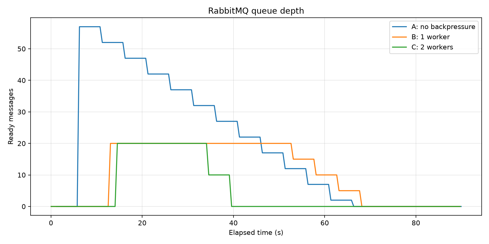
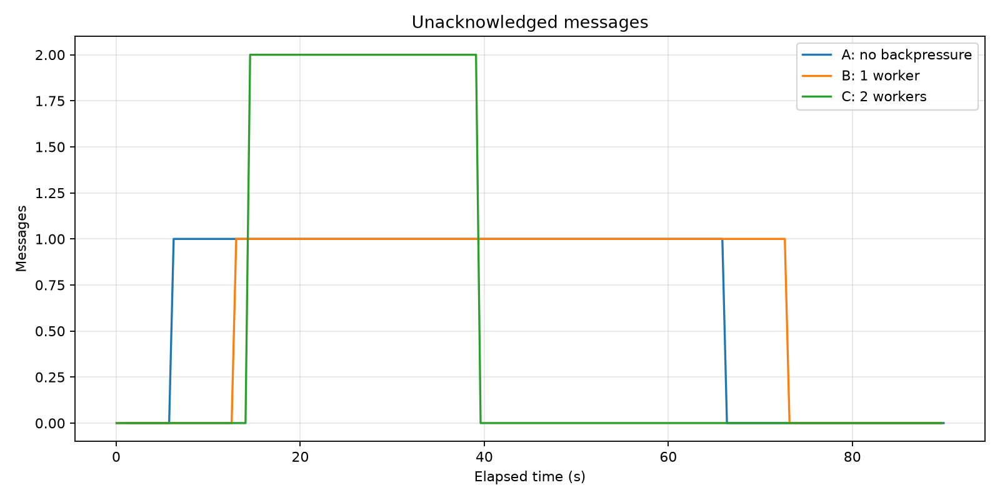
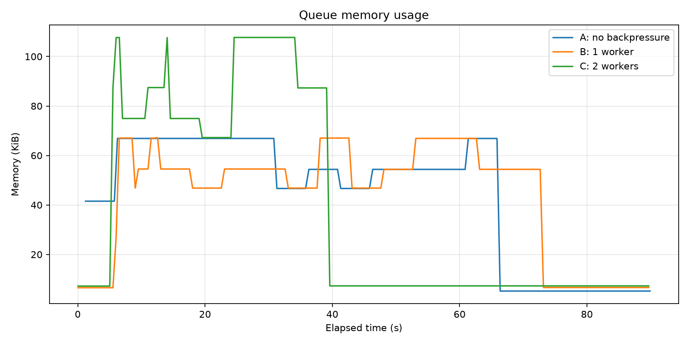
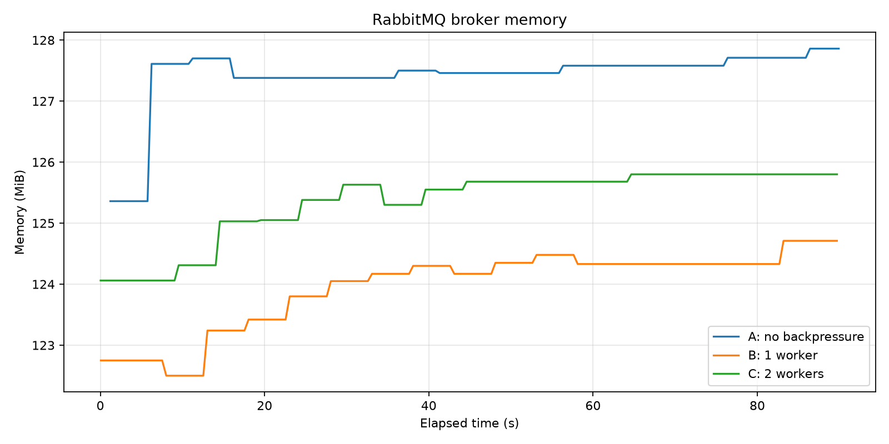
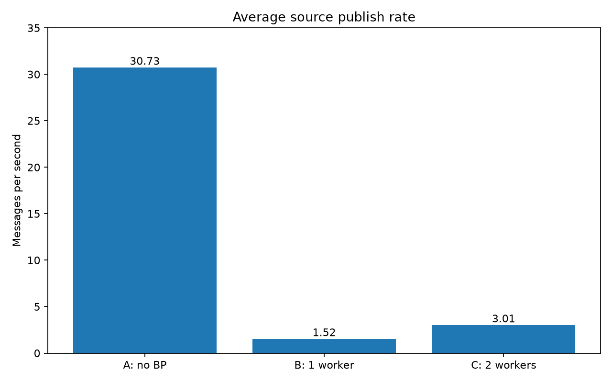
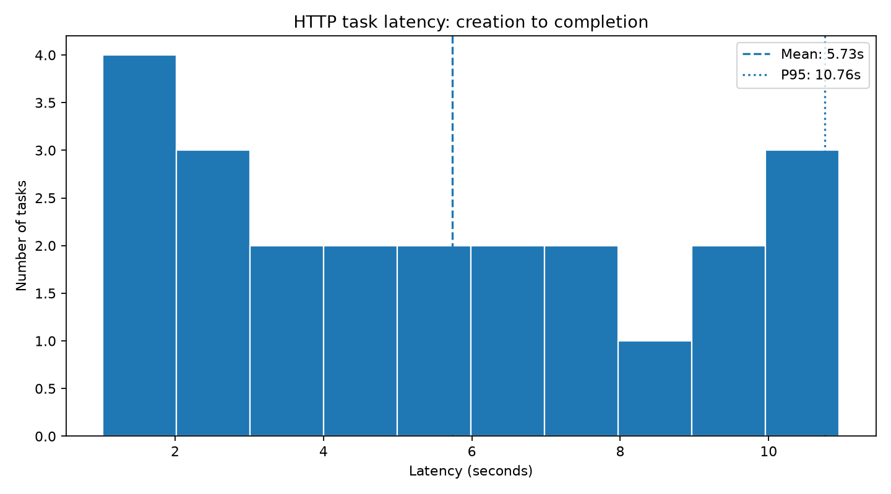

# Music Mood Search

Асинхронный веб-сервис на FastAPI, разработанный в рамках курса MLOps.

В дальнейшем проект будет использоваться как основа для сервиса **Music Mood Search**: системы поиска музыкальных треков по текстовому описанию настроения, жанра и инструментов.

На текущем этапе реализована инфраструктурная часть проекта:

- асинхронное FastAPI-приложение;
- подключение к PostgreSQL;
- health-check эндпоинты;
- тестирование и измерение покрытия;
- статический анализ и форматирование;
- Docker и Docker Compose;
- pre-commit hooks;
- CI pipeline;
- CD pipeline;
- версионирование Docker-образов;
- публикация образов в GitHub Container Registry;
- структурированное JSON-логирование.

## Быстрый старт

```bash
cp .env.example .env
docker compose up --build -d
docker compose ps
```

После запуска:

- API и Swagger: http://localhost:8000/docs
- MLflow UI: http://localhost:5000

Сервис берёт модель из MLflow Model Registry. Если модель ещё не обучена (новое окружение, пустой Registry), приложение запустится, но `/api/v1/process` и `/api/v1/health` будут отвечать `503`. Как обучить и зарегистрировать модель: [Полный цикл обучения](#полный-цикл-обучения).

Проверка, что модель загружена и отвечает:

```bash
curl -s http://localhost:8000/api/v1/model | python3 -m json.tool
uv sync --group training
uv run --env-file .env --group training python training/demo_request.py --n 3
```

## MLflow

Добавлен полный ML-цикл для классификатора тегов поверх эмбеддингов
EffNet-Discogs. Модель размечает трек по четырём категориям: `genre`,
`instrument`, `mood` и `theme` (назначение музыки: кино, реклама, игры и т.д.).

- MLflow Tracking Server в Docker Compose: Backend Store в PostgreSQL
  (`mlflow-db`), Artifact Store в MinIO (S3);
- EDA и анализ похожести тегов как артефакты MLflow;
- Dataset Tracking: версии датасета в MinIO (`v1`, `v2`), source и digest в MLflow;
- эксперименты: родительский Run и вложенные Runs для каждого семейства моделей;
- Model Registry: alias `champion` (рабочая версия) и `previous` (для отката);
- модель загружается из Registry по alias один раз при старте приложения;
- `POST /api/v1/process` и `GET /api/v1/model`.

Подробности и результаты: раздел [Обучение модели](#обучение-модели) и
отчёт по текущей версии [reports/model-v6](reports/model-v6/README.md).

## Структура проекта

```text
music-mood-search/
├── .github/
│   └── workflows/
│       ├── ci.yml
│       └── cd.yml
│
├── docker/
│   └── mlflow/
│       └── Dockerfile          # образ MLflow Tracking Server
│
├── src/
│   └── music_mood_search/
│       ├── api/
│       │   ├── __init__.py
│       │   ├── health.py
│       │   └── process.py      # POST /api/v1/process, GET /api/v1/model
│       │
│       ├── services/
│       │   ├── __init__.py
│       │   ├── health.py
│       │   └── model.py        # загрузка модели из Model Registry
│       │
│       ├── __init__.py
│       ├── app.py
│       ├── config.py
│       ├── db.py
│       ├── logging_config.py
│       └── schemas.py
│
├── training/
│   ├── data/
│   │   ├── extract_embeddings.py   # эмбеддинги EffNet-Discogs из аудио
│   │   └── requirements.txt
│   ├── common.py                   # датасет, Dataset Tracking, метки, группы тегов
│   ├── demo_request.py             # демонстрационный запрос к /process
│   ├── eda.py                      # EDA, артефакты в MLflow
│   ├── metrics.py                  # PR-AUC, precision@k, hit@k, интервалы
│   ├── music_tagger_pyfunc.py      # pyfunc-обёртка модели
│   ├── registry.py                 # версии, alias champion и previous
│   ├── tag_groups.json             # группы тегов mood и theme
│   ├── tag_similarity.py           # анализ похожести тегов для группировки
│   ├── tagger_heads.py             # классификаторы: logreg, kNN, MLP (PyTorch)
│   ├── train.py                    # Runs, метрики, сборка и регистрация модели
│   └── upload_dataset.py           # загрузка датасета в MinIO
│
├── reports/
│   └── model-v6/                   # метрики и графики текущей версии модели
│
├── tests/
│   ├── __init__.py
│   ├── conftest.py
│   ├── fakes.py
│   ├── test_health.py
│   ├── test_model_service.py
│   ├── test_process.py
│   └── test_training.py
│
├── .dockerignore
├── .env.example
├── .gitattributes
├── .gitignore
├── .pre-commit-config.yaml
├── Dockerfile
├── docker-compose.yml
├── pyproject.toml
├── uv.lock
└── README.md
```

## Используемые технологии

- Python 3.12
- FastAPI
- Uvicorn
- PostgreSQL 17
- asyncpg
- Pydantic Settings
- MLflow
- MinIO
- scikit-learn
- PyTorch (CPU)
- NumPy
- pandas
- Essentia
- uv
- pytest
- pytest-asyncio
- pytest-cov
- HTTPX
- Ruff
- pre-commit
- Docker
- Docker Compose
- GitHub Actions
- GitHub Container Registry

## API

В приложении реализованы пять эндпоинтов.

### `GET /healthz`

Быстрая проверка того, что само приложение работает.


Эндпоинт намеренно не находится внутри `/api/v1`, так как используется не пользователями API, а инфраструктурой: Docker, оркестраторами и системами мониторинга.

### `GET /api/v1/version`

Возвращает текущую версию приложения.


Версия не хранится отдельно внутри endpoint. Она получается из metadata установленного Python-пакета, а источником версии является `pyproject.toml`.

### `GET /api/v1/health`

Выполняет end-to-end health-check сторонних компонентов приложения.

На текущем этапе проверяются PostgreSQL и модель из MLflow Model Registry.

Эндпоинт возвращает:

- общий статус;
- состояние каждого компонента (`database`, `model`);
- версию компонента (для модели: имя, версия и alias);
- время ответа;
- информацию об ошибке при недоступности компонента.

Если PostgreSQL недоступен или модель не загружена, endpoint возвращает HTTP-код `503 Service Unavailable`.

### `GET /api/v1/model`

Показывает, какая модель обслуживает запросы: имя, alias, версию, `run_id` в MLflow и URI загруженной версии.

Поле `embedding` описывает, каким должен быть входной эмбеддинг: модель EffNet-Discogs, слой, частота дискретизации, усреднение по времени, размерность. Эмбеддинги, полученные иначе, модель примет, но предсказания будут бессмысленными. У старых версий модели (до v5) поле равно `null`.

Если модель не загружена, возвращает `503 Service Unavailable`.

### `POST /api/v1/process`

Принимает до 64 эмбеддингов EffNet-Discogs (по 1280 чисел в каждом) и возвращает для каждого трека теги четырёх категорий: `genre`, `instrument`, `mood` и `theme`. У каждого тега есть оценка (`score`). В каждой категории возвращаются теги выше порога (не больше трёх), а если порог не прошёл ни один, то самый вероятный.

Для `mood` и `theme` возвращаются группы тегов (например, `calm` или `cinematic`), а не исходные теги датасета. Если у модели нет классификатора категории (старые версии без `theme`), возвращается пустой список.

Запрос отклоняется с кодом `422`, если эмбеддинг неверной длины, пакет больше 64 или среди значений есть `NaN` или бесконечность.

Модель синхронная, поэтому inference выполняется в пуле потоков (`run_in_threadpool`) и не блокирует event loop.

Пример запроса:

```json
{ "embeddings": [[0.01, 0.02, "... 1280 чисел ..."]] }
```

В ответе:

- `model` с информацией о версии модели, которая дала предсказание;
- `predictions` со списками тегов для каждого трека;
- `inference_ms`, время работы модели.

## Обучение модели

### Полный цикл обучения

Нужны запущенные сервисы (`docker compose up -d`) и эмбеддинги в `training/data/out/` (их создаёт `training/data/extract_embeddings.py` из аудио MTG-Jamendo). Все команды выполняются из корня репозитория.

```bash
uv sync --group training
# в .env переменная DATASET_URI указывает, какую версию данных использовать

# 1. Загрузить датасет в MinIO (версия не перезаписывается)
uv run --env-file .env --group training python training/upload_dataset.py \
    --file training/data/out/embeddings.parquet \
    --manifest training/data/out/manifest.json

# 2. EDA и анализ похожести тегов
uv run --env-file .env --group training python training/eda.py
uv run --env-file .env --group training python training/tag_similarity.py

# 3. Обучение, выбор версии, перезапуск сервиса
uv run --env-file .env --group training python training/train.py
uv run --env-file .env --group training python training/registry.py promote
docker compose restart app

# 4. Демонстрационный запрос
uv run --env-file .env --group training python training/demo_request.py --n 3
```

Для быстрой проверки всей цепочки: `train.py --smoke --no-register` (2 фолда, одна точка сетки, несколько эпох).

### Данные

- **Источник:** MTG-Jamendo, подмножество moodtheme, официальное разбиение `split-0` на train, validation и test. Треки одного артиста не попадают в разные части.
- **Признаки:** эмбеддинги EffNet-Discogs (1280 чисел), усреднённые по всему треку. Извлекаются скриптом `training/data/extract_embeddings.py`.
- **Версии:** датасет лежит в MinIO по пути `s3://datasets/mtg-jamendo-moodtheme/vN/embeddings.parquet`. Версия не перезаписывается: новые данные загружаются в новую папку (`v1`: 1889 треков, `v2`: около 5,5 тысячи). Скрипты берут версию из `DATASET_URI` (или `--data`) и без неё не запускаются, чтобы не обучиться случайно на устаревших данных.
- **Dataset Tracking:** в каждом Run записываются URI, sha256 файла и версия данных. Каждая часть (train, validation, test) логируется как MLflow Dataset со своим digest.

### Категории и группы тегов

`genre` и `instrument` используют теги датасета как есть. Теги настроения и назначения музыки объединены в группы (`training/tag_groups.json`): например, `calm` включает calm, relaxing, meditative, soft и hopeful, а `cinematic` включает film, movie, trailer, drama, action и adventure. Отдельных тегов слишком много, они редкие и по звучанию часто неразличимы (calm и relaxing, sad и melancholic).

Группы подобраны по смыслу и проверены скриптом `training/tag_similarity.py`: он считает косинусную близость средних эмбеддингов тегов и для каждой группы проверяет, что её теги ближе друг к другу, чем к соседней группе. Дополнительно дендрограммы в [reports/model-v6/tag_similarity](reports/model-v6/tag_similarity).

Каждая категория обучается и оценивается только на треках, где она размечена. Классификатор инструментов не видит треки без тегов инструментов: отсутствие тега там означает «не размечено», а не «инструмента нет».

### Модели и подбор

Для каждой категории обучается отдельный классификатор. Сравниваются четыре семейства:

| Семейство | Описание | Сетка гиперпараметров |
|---|---|---|
| `logreg` | логистическая регрессия на каждый тег (baseline) | C: 0.01, 0.1, 1 |
| `knn` | k ближайших соседей, косинусная близость | k: 10, 20, 50 |
| `mlp_bce` | один скрытый слой, PyTorch, binary cross-entropy | hidden 256/512, dropout 0.2/0.5 |
| `mlp_asl` | то же с asymmetric loss (для редких тегов) | плюс gamma_neg 2/4 |

Роли выборок:

- **train:** обучение, подбор гиперпараметров и порогов. Кросс-валидация GroupKFold (5 фолдов) по артистам, чтобы песни одного исполнителя не попадали одновременно в обучение и проверку. Порог для каждого тега подбирается по F1 на out-of-fold предсказаниях.
- **validation:** только выбор семейства внутри категории.
- **test:** один раз, для итоговой оценки собранной модели.

Выбранные классификаторы собираются в одну pyfunc-модель (`training/music_tagger_pyfunc.py`). Вместе с моделью сохраняются описание эмбеддинга, версия и sha256 данных, sha256 файла групп.

В MLflow один запуск `train.py` выглядит так: родительский Run `tagger-v2-groups` и вложенные Runs `mood/logreg`, `mood/knn` и т.д. В каждом вложенном Run записаны гиперпараметры, CV-метрики и метрики на validation. В родительском Run записаны итоговые метрики на test, диагностика и зарегистрированная модель.

### Метрики

- **PR-AUC (macro)** по тегам: основная метрика. Не зависит от порога и честно работает при редких тегах. У случайной модели PR-AUC равен доле треков с тегом.
- **precision@10:** доля верных среди 10 треков с наибольшей оценкой тега. Отвечает на вопрос пользователя «найди мне спокойную музыку».
- **hit@3:** доля треков, у которых среди трёх предложенных тегов есть верный.
- **F1** по подобранным порогам: качество итоговых тегов в ответе сервиса.
- **Общая метрика** `val_pr_auc_overall`: среднее PR-AUC по категориям с равными весами (веса задаются `--weights mood=2`). По ней сравниваются версии в Registry.
- **Доверительный интервал** PR-AUC на test: 200 раз берётся случайная половина треков (без повторений) и считается разброс метрики. Если интервалы двух моделей сильно пересекаются, разница между ними может быть случайной.

### Результаты (версия 6)

| Категория | Модель | val PR-AUC | test PR-AUC [95% ДИ] | test P@10 | test hit@3 |
|---|---|---|---|---|---|
| mood | mlp_asl | 0.275 | 0.295 [0.275; 0.316] | 0.464 | 0.70 |
| theme | mlp_bce | 0.289 | 0.318 [0.283; 0.354] | 0.511 | 0.79 |
| genre | knn | 0.287 | 0.258 [0.232; 0.284] | 0.377 | 0.81 |
| instrument | mlp_bce | 0.209 | 0.248 [0.218; 0.277] | 0.495 | 0.79 |
| **общая** | | 0.265 | 0.280 | 0.462 | |

PR-AUC выше случайного уровня от 3 раз (mood) до 16 раз (genre, где много редких тегов). У 70-80% треков среди трёх предложенных тегов есть верный.

Подробнее: [reports/model-v6](reports/model-v6/README.md) (проверка групп тегов, дендрограммы).

### Выбор версии в Model Registry

```bash
uv run --env-file .env --group training python training/registry.py list
uv run --env-file .env --group training python training/registry.py promote
uv run --env-file .env --group training python training/registry.py set-alias --version 6
```

`promote` назначает `champion` лучшей версии по `val_pr_auc_overall` и соблюдает два правила:

- сравниваются только версии с одинаковой постановкой: тот же датасет (sha256) и те же группы тегов. Метрики на разных данных или разных наборах меток несравнимы;
- новая версия не проходит, если хотя бы одна категория хуже текущего `champion` больше чем на `--tolerance`.

При смене `champion` прежняя версия получает alias `previous`, поэтому откат выполняется одной командой.

### Смена модели без изменения кода

Приложение загружает модель `models:/music-tagger@champion` один раз при старте. Чтобы сменить версию, нужно переназначить alias и перезапустить сервис:

```bash
uv run --env-file .env --group training python training/registry.py set-alias --version 5
docker compose restart app
curl -s http://localhost:8000/api/v1/model    # "version": "5"
```


## Конфигурация

Настройки приложения загружаются через `pydantic-settings`.

Для локального запуска необходимо создать `.env` на основе `.env.example`.

При работе приложения внутри Docker Compose используется внутренний адрес PostgreSQL:

```text
postgresql://postgres:postgres@db:5432/postgres
http://mlflow:5000
```

Настройки модели:

| Переменная | Назначение | По умолчанию |
|---|---|---|
| `MLFLOW_TRACKING_URI` | адрес MLflow Tracking Server | `http://mlflow:5000` внутри Compose |
| `MODEL_NAME` | имя модели в Model Registry | `music-tagger` |
| `MODEL_ALIAS` | alias версии, которая обслуживает запросы | `champion` |

Скриптам из `training/` дополнительно нужны:

| Переменная | Назначение |
|---|---|
| `DATASET_URI` | версия датасета, например `s3://datasets/mtg-jamendo-moodtheme/v2/embeddings.parquet` (обязательна) |
| `MLFLOW_S3_ENDPOINT_URL` | адрес MinIO, `http://localhost:9000` |
| `AWS_ACCESS_KEY_ID`, `AWS_SECRET_ACCESS_KEY` | доступ к MinIO |


## Ruff

Для статического анализа и форматирования используется Ruff.

Проверка кода:

```bash
uv run ruff check .
```

Проверка форматирования:

```bash
uv run ruff format --check .
```

Автоматическое форматирование:

```bash
uv run ruff format .
```

В конфигурации Ruff используются правила для:

- стандартных ошибок Python;
- ошибок оформления;
- сортировки импортов;
- поиска распространённых потенциальных ошибок;
- использования современного синтаксиса Python.

## Тестирование

Запуск тестов:

```bash
uv run pytest -v
```

Запуск тестов с измерением покрытия:

```bash
uv run pytest --cov=music_mood_search --cov-report=term-missing
```

Проверяются следующие сценарии:

- успешный `/healthz`;
- успешный `/api/v1/version`;
- успешный `/api/v1/health`;
- ситуации, когда PostgreSQL недоступен или модель не загружена;
- загрузка модели: alias превращается в конкретную версию, повторные попытки при ошибке;
- `POST /api/v1/process`: успешный запрос, неверная размерность эмбеддинга, слишком большой пакет, ответ `503` без модели;
- `GET /api/v1/model`;
- код обучения (`tests/test_training.py`): метрики, классификаторы и их сохранение, разметка по группам тегов, правила `promote`, доверительные интервалы, версия данных.

MLflow и модель в тестах API подменяются (`tests/fakes.py`), поэтому тесты не требуют запущенного MLflow. Тест MLP пропускается, если PyTorch не установлен.

Минимально допустимое покрытие:

```text
80%
```

Если coverage становится ниже 80%, проверка завершается ошибкой.

## Pre-commit

Для автоматических проверок перед каждым коммитом используется `pre-commit`.

Установка Git hook:

```bash
uv run pre-commit install
```

Ручной запуск всех проверок:

```bash
uv run pre-commit run --all-files
```

В pre-commit настроены:

- удаление trailing whitespace;
- проверка конца файлов;
- проверка YAML;
- проверка TOML;
- проверка больших файлов;
- проверка merge conflicts;
- проверка конфликтов регистра имён файлов;
- нормализация line endings;
- Ruff lint;
- Ruff format.

При выполнении:

```bash
git commit
```

pre-commit запускается автоматически.

## Docker

Сборка Docker-образа:

```bash
docker build -t music-mood-search:local .
```

Dockerfile использует:

- `python:3.12-slim`;
- установку зависимостей через `uv`;
- фиксированные зависимости из `uv.lock`;
- отдельные Docker layers для зависимостей и исходного кода;
- только production-зависимости;
- непривилегированного пользователя `appuser`.

Проверить пользователя контейнера:
```bash
docker compose exec app whoami
```

Приложение внутри контейнера запускается не от `root`.

## Docker Compose

Запустить приложение, PostgreSQL и MLflow с хранилищем:

```bash
docker compose up --build -d
```

Проверить состояние контейнеров:

```bash
docker compose ps
```

Все основные сервисы должны иметь статус `healthy`:

```text
app          healthy
db           healthy
mlflow       healthy
mlflow-db    healthy
minio        healthy
```

Сервис `minio-init` разовый: он создаёт бакеты `mlflow` и `datasets` и завершается со статусом `Exited (0)`.

Адреса с хостовой машины:

```text
API:           http://localhost:8000
MLflow UI:     http://localhost:5000
MinIO S3 API:  http://localhost:9000
PostgreSQL:    localhost:55432
```

Используемый образ MinIO (`bitnamilegacy/minio`) не содержит веб-консоли, поэтому порт 9001 не отвечает. Содержимое бакетов можно посмотреть через AWS CLI или boto3.

Docker Compose содержит:

- сервис приложения;
- PostgreSQL приложения;
- MLflow Tracking Server и Model Registry;
- отдельный PostgreSQL для Backend Store MLflow;
- MinIO (S3) как Artifact Store;
- отдельную Docker network;
- persistent volumes для обеих баз и для MinIO;
- healthcheck каждого сервиса;
- ограничения памяти;
- ротацию логов;
- restart policy.


Просмотр логов приложения:

```bash
docker compose logs app
```

Просмотр логов в реальном времени:

```bash
docker compose logs -f app
```

Остановка сервисов:

```bash
docker compose down
```

## Логирование

В приложении реализовано структурированное JSON-логирование.


Логируются:

- запуск приложения;
- создание пула соединений с PostgreSQL;
- HTTP-метод;
- URL запроса;
- HTTP status code;
- время выполнения запроса;
- завершение приложения;
- закрытие connection pool;
- загрузка модели из MLflow (URI, версия, `run_id`, номер попытки);
- каждый вызов inference (версия модели, размер пакета, время).

## CI

Continuous Integration реализован через GitHub Actions.

CI запускается:

- при push в `main`;
- при pull request в `main`.

Pipeline выполняет:

```text
Checkout
   ↓
Установка uv и Python
   ↓
Установка зависимостей
   ↓
Ruff lint
   ↓
Ruff format check
   ↓
pytest
   ↓
coverage check
```

Pipeline завершится ошибкой, если:

- Ruff обнаружит ошибку;
- код неправильно отформатирован;
- хотя бы один тест не пройдёт;
- coverage станет ниже 80%.

## CD

Continuous Delivery также реализован через GitHub Actions.

CD запускается только при push Git-тега формата:

```text
v*.*.*
```

Перед публикацией Docker-образа pipeline сравнивает версию Git-тега с версией приложения из `pyproject.toml`.

Например:

```text
pyproject.toml: 0.1.1
Git tag:        v0.1.1
```

Если версии не совпадают, CD завершается ошибкой.

Такой подход предотвращает случайную публикацию образа с неправильной версией.

## GitHub Container Registry

Docker-образы публикуются в:

```text
ghcr.io/patrikkstar/music-mood-search
```

Для релиза `v0.1.1` создаются следующие теги:

```text
0.1.1
0.1
latest
sha-1dc2e5d
```

Назначение тегов:

- `0.1.1`: конкретная версия приложения;
- `0.1`: последняя patch-версия ветки `0.1`;
- `latest`: последний опубликованный релиз;
- `sha-*`: образ, соответствующий конкретному Git-коммиту.

Скачать конкретную версию:

```bash
docker pull ghcr.io/patrikkstar/music-mood-search:0.1.1
```

## Git workflow

Полный процесс разработки выглядит следующим образом:

```text
изменение кода
      ↓
git commit
      ↓
pre-commit
      ↓
git push
      ↓
CI
      ↓
создание version tag
      ↓
CD
      ↓
GitHub Container Registry
```

Обычный push в `main` запускает CI, но не создаёт новый Docker-релиз.

Для выпуска новой версии необходимо явно создать Git-тег:

```bash
git tag -a v0.1.1 -m "Release v0.1.1"
git push origin v0.1.1
```

После этого автоматически запускается CD и публикуется новый Docker-образ.

## Версии

Текущие релизы:

```text
v0.1.0: первая рабочая инфраструктурная версия
v0.1.1: добавлено структурированное логирование
```


## Исследование механизмов backpressure

### Цель

Проверить, как ограничение длины очереди RabbitMQ, publisher
confirms и адаптивные повторы публикации влияют на поведение
системы при превышении скорости поступления задач над
скоростью их обработки.

### Конфигурация экспериментов

Для всех сценариев использовались:
- 60 задач с эмбеддингами размерности 1280;
- MLflow-модель `music-tagger`, версия 1, alias `champion`;
- искусственная задержка inference — 1 секунда;
- RabbitMQ с publisher confirms;
- ручное подтверждение обработки сообщений;
- мониторинг RabbitMQ Management API с интервалом 0,5 с.

Исследовались три конфигурации:

- **A — без backpressure:** отдельная неограниченная очередь,
  один последовательный потребитель, prefetch=1. Источник
  публикует задачи без адаптивного замедления.
- **B — backpressure, 1 worker:** очередь с `x-max-length=20`,
  `x-overflow=reject-publish`, prefetch=1. При отказе источник
  повторяет публикацию с экспоненциальной задержкой.
- **C — backpressure, 2 workers:** конфигурация B с двумя
  параллельно работающими экземплярами воркера.

### Результаты

| Метрика | A | B | C |
|---|---:|---:|---:|
| Опубликовано задач | 60 | 60 | 60 |
| Максимум ready | 57 | 20 | 20 |
| Максимум unacked | 1 | 1 | 2 |
| Consumers | 1 | 1 | 2 |
| Отказы публикации | 0 | 129 | 63 |
| Время публикации, с | 1,95 | 39,6 | 19,9 |
| Средняя скорость, msg/s | 30,73 | 1,52 | 3,01 |
| Макс. память очереди, байт | 68 512 | 68 816 | 110 296 |
| Макс. память брокера, МБ | 127,86 | 124,71 | 125,80 |
| Успешно обработано | 60 | 60 | 60 |

Отказы публикации отражают количество отклонённых попыток,
а не количество потерянных задач.

Скорость публикации учитывает начальное заполнение очереди
и не равна устойчивой скорости обработки задач.

### Графики

**Глубина очереди RabbitMQ**



**Количество сообщений без подтверждения (unacked)**



**Потребление памяти очереди**



**Потребление памяти RabbitMQ**



**Средняя скорость публикации источника**



### Анализ результатов

**Без backpressure (A).**

Источник опубликовал 60 задач за 1,95 с, тогда как
обработка одной задачи занимала в среднем около 1 с.
В результате очередь накопила до 57 ожидающих сообщений.

Это демонстрирует, что высокая скорость приёма сообщений
не означает высокой производительности обработки.
Без ограничения очереди продолжительная перегрузка может
привести к значительному накоплению сообщений.

**С backpressure (B).**

Максимальная глубина очереди составила 20 сообщений,
что соответствует установленному ограничению.

RabbitMQ отклонял публикации при заполнении очереди.
Источник обрабатывал отказы и повторял отправку с задержкой.
Зафиксировано 129 отклонённых попыток; все 60 задач
в итоге были успешно опубликованы и обработаны.

**Масштабирование до двух воркеров (C).**

При двух воркерах число unacked не превышало 2,
а максимальная глубина очереди осталась равной 20.

Средняя скорость публикации увеличилась с 1,52 до
3,01 msg/s — примерно в 1,98 раза.
Время публикации сократилось с 39,6 до 19,9 с.

Количество отклонённых попыток снизилось со 129 до 63.

**Память RabbitMQ.**

В пределах коротких экспериментов память брокера
оставалась примерно в диапазоне 122–128 МБ.

Полученные измерения не доказывают уменьшения общего
потребления памяти благодаря backpressure: на него также
влияют внутренние структуры RabbitMQ и количество
подключённых потребителей.

### Ограничения сравнения

Эксперимент A использует отдельный потребитель с той же
MLflow-моделью и задержкой, но без сохранения результата
в PostgreSQL. Эксперименты B и C используют основной
FastStream-воркер с записью результатов в БД.

Поэтому A демонстрирует эффект неограниченного накопления
сообщений, но не является полностью эквивалентным
сравнением производительности всего приложения.

Средняя продолжительность inference для экспериментов
с backpressure составила 1003,29 мс по выборке из
120 завершённых задач. Полная end-to-end latency,
включающая ожидание в очереди, отдельно не измерялась.

### Вывод

Реализованный механизм backpressure обеспечивает:

1. Ограничение длины ожидающей очереди RabbitMQ.
2. Адаптивное снижение скорости источника при перегрузке.
3. Ограничение количества сообщений, переданных воркерам
   без подтверждения, через prefetch.
4. Увеличение пропускной способности при горизонтальном
   масштабировании воркеров.
5. Успешную обработку всех задач в проведённых экспериментах.

Таким образом, backpressure не ускоряет отдельно взятую
операцию inference, но предотвращает неконтролируемое
накопление задач и позволяет согласовать скорость
публикации с возможностями обработчиков.


### Задержка HTTP-задач

Дополнительно измерена задержка от создания записи в
PostgreSQL до сохранения результата обработки.

По 23 завершённым задачам получены следующие показатели:

| Метрика | Значение |
|---|---:|
| Средняя задержка | 5733,62 мс |
| P95 | 10756,29 мс |
| Максимальная задержка | 10952,40 мс |



Задержка включает ожидание обработки в RabbitMQ и выполнение
inference, но не включает сетевое время до создания записи в БД.

Прямые публикации через batch_source.py в расчёт не включены.
Данное измерение не заменяет отдельные оценки latency
для экспериментов A, B и C.
